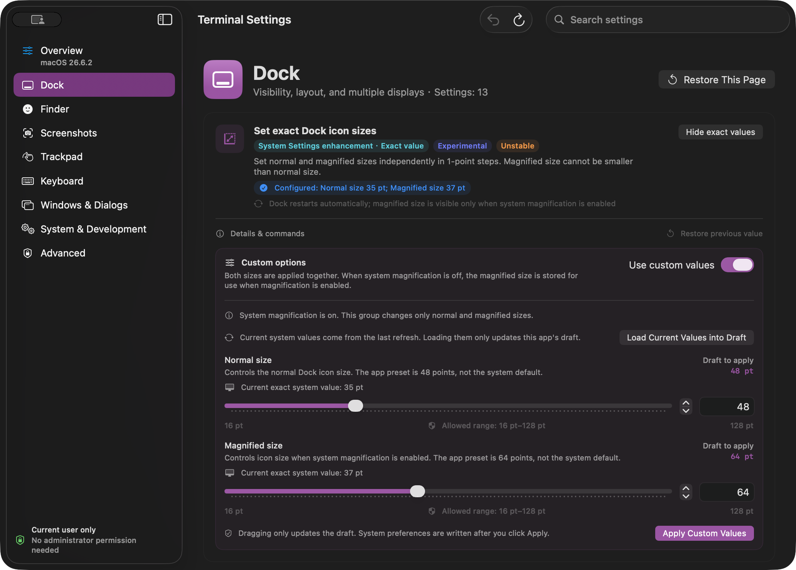

# Terminal Settings

Bring macOS preferences usually adjusted with Terminal commands into a native interface with explanations, command previews, and recovery options. This app manages system preferences; it is not a settings editor for Terminal.app.

[简体中文](README.zh-CN.md) · [Download preview](https://github.com/muyuzy123-pixel/macos-terminal-settings/releases/tag/v1.10.0-preview.1) · [Contributing](CONTRIBUTING.md) · [Security](SECURITY.md)

**Current preview:** `v1.10.0-preview.1` · App **1.10.0 (Build 19)** · [MIT license](LICENSE)

**Languages:** The preview download includes English, Simplified Chinese, and Spanish. **Spanish translations have not yet been reviewed by a native speaker.**

This guide describes the published **1.10.0 (Build 19)** preview. See the [release notes](docs/publication/v1.10.0-preview.1-notes.md), [frozen source](https://github.com/muyuzy123-pixel/macos-terminal-settings/commit/e8f62725eb61d4e1cd1c9779a3dfb7ec4cf2a414), [source CI](https://github.com/muyuzy123-pixel/macos-terminal-settings/actions/runs/38256266681), and [release verification](https://github.com/muyuzy123-pixel/macos-terminal-settings/blob/main/docs/publication/v1.10.0-preview.1-verification.json). Published at **2026-10-12T13:39:28Z**.

Older `v1.9.0-preview.2` downloads use the earlier interface, immediate Dock/Finder restarts, and in-app administrator authorization for power settings. Their assets are unchanged; the [tagged usage guide](https://github.com/muyuzy123-pixel/macos-terminal-settings/blob/v1.9.0-preview.2/README.md) documents that version. **Physical hover timing and VoiceOver behavior have not been accepted in the running app.**

See [release status](docs/RELEASE_STATUS.md) for distribution status and verified scope.



*English interface of 1.10.0 (Build 19), captured at native 2× resolution in an isolated copy. The 48/64-point drafts have not been applied; current system values remain 35/37 points. This screenshot does not demonstrate Apply, process restarts, hover timing, or VoiceOver acceptance.*

## Features

The app includes **40 settings across 8 categories**, with **7 numeric control groups and 10 parameters**.

| Category | Settings | Examples |
| --- | ---: | --- |
| Dock | 13 | Icon sizes, animation timing, multi-display behavior |
| Finder | 6 | Window title paths, network and USB metadata preferences |
| Screenshots | 4 | Image format, window shadows, file names |
| Trackpad | 1 | Experimental legacy three-finger double-tap preference |
| Keyboard | 2 | Key repeat rate and press-and-hold behavior |
| Windows & dialogs | 7 | Window animations and expanded save dialogs |
| System & development | 4 | Menu bar spacing and screen saver idle time |
| Advanced | 3 | Power wake and keep-awake flags (read-only; changed with Terminal commands) |

- **See what will change.** View current values, descriptions, risk labels, sources, and equivalent commands.
- **Edit precise values.** Keep numeric drafts separate from the current system value; review the submission paths described below.
- **Work in your language.** Switch between English, Simplified Chinese, and Spanish immediately; search in any of them or by preference key. Numbers follow the system region.
- **Undo and recover.** The app records values before changing them and checks management restrictions and external edits before restoring them.

The catalog distinguishes **34 Terminal-only settings**, **4 System Settings enhancements**, and **2 mirrors**. Some preferences are undocumented or experimental. Availability and effects vary by macOS version; a successful write/read-back confirms the stored value, not its visible effect.

## Download and install

| Requirement | Current support |
| --- | --- |
| Hardware | Apple silicon (`arm64`); no Intel build is supplied |
| Deployment target | macOS 14.0 or later; individual features may require a newer version |
| Local validation | macOS 26.6.2; real-device macOS 14 acceptance is still outstanding |
| Distribution | Preview build, ad-hoc signed with Hardened Runtime; no Developer ID or notarization |

The frozen Build 19 source, contract, build, archive, and isolated GUI results are described in the [release verification](https://github.com/muyuzy123-pixel/macos-terminal-settings/blob/main/docs/publication/v1.10.0-preview.1-verification.json). Earlier integration and GUI reports remain historical evidence. Static and controlled tests do not establish all visible system effects, physical hover timing, VoiceOver behavior, or runtime acceptance on macOS 14; see [testing](docs/TESTING.md).

1. Open the [preview release](https://github.com/muyuzy123-pixel/macos-terminal-settings/releases/tag/v1.10.0-preview.1) and download `TerminalSettings.zip` and `SHA256SUMS` from **Assets**. The release also includes `release-manifest.json` with build and verification details.
2. In the folder containing both downloaded files, verify the archive:

   ```sh
   shasum -a 256 -c SHA256SUMS
   ```

   The expected result is `TerminalSettings.zip: OK`. If verification fails, stop installation and download both files again from the same release; [report the problem](https://github.com/muyuzy123-pixel/macos-terminal-settings/issues/new?template=bug_report.md) if it persists.
3. Quit any older copy, extract the ZIP, and move `TerminalSettings.app` to Applications before opening it.

This preview is **not notarized**, so macOS may block it. Review [Apple's guidance on opening downloaded apps](https://support.apple.com/en-us/102445) and the project's [security boundaries](SECURITY.md) before deciding to run it. A matching checksum confirms the downloaded file matches the release; it does not establish that the software is safe.

## Using the app

Choose **语言 / Language** (shown as **Idioma / Language** in Spanish) in Overview to follow the system language, or use Simplified Chinese, English, or Spanish. Browse a category or search for a setting, then read its effect, compatibility notes, and command preview. Settings without a source label are Terminal-only; System Settings enhancements and mirrors are labeled. Keyboard: ⌘1–⌘9 switch categories, ⌘R refreshes the status, and ⌥⌘Z undoes the last change (⌘Z stays with text editing).

**Numeric edits update drafts first.** Expanding an editor, moving a slider, typing a value, selecting a draft preset, or loading the current value does not by itself change system preferences. **Apply** buttons submit changes; **turning on the corresponding feature may also apply the selected custom draft**. Numeric drafts and editing modes are retained between launches.

**Main feature switches and menus that directly select system values execute changes when operated**—for example, Dock alignment and screenshot file format. Language selection, draft presets, and the custom-editing mode switch only update app state or drafts. Some changes take effect only after Dock or Finder restarts. Dock schedules one restart after a 3-second quiet period and waits for writes or refreshes to finish; choose **Later** to postpone it. Finder restarts only when you click **Restart Finder Now**, because relaunching it reopens its windows and can interrupt a copy. If you quit during Dock's countdown, Dock restarts immediately; postponed and Finder restarts are left to you. Pending restart reminders are retained between launches; after reopening, they wait for your confirmation, including a restored Dock countdown. **Restart Now** is unavailable while a write or status refresh is in progress. The Advanced category only reads its power settings and offers fixed `sudo pmset` commands to copy and run in Terminal; the app never requests administrator authorization. **Restore This Page** sits next to each category title and asks for confirmation first. Follow the effect and restart information shown for the setting.

Recovery actions have distinct meanings:

| Action | What it does |
| --- | --- |
| Undo last change | Restores the preceding transaction's snapshot, subject to management and conflict checks |
| Delete current explicit value | When checks allow, removes the current override, including one originally set by another tool; the system then resolves the effective value. This is not a factory reset and does not bypass management restrictions |
| Restore pre-app value | Restores the recorded value or absence from before the app first took control; restoration is blocked when an external change is detected |

Advanced power settings change only through the copied Terminal commands: an off command writes `0`, and these changes are not part of in-app Undo. Items with managed, unreadable, conflicting, or unresolved recovery state may remain read-only.

Deleting `TerminalSettings.app` does not automatically undo applied settings or clear the app’s local preferences and recovery records. To revert changes, first use the available Undo or per-setting recovery actions. Keep recovery data while a transaction is unresolved; deleting its journal does not safely resolve it.

## Permissions and local data

Ordinary settings use the current user's preferences, including current-host domains where required. The Advanced category reads only three `pmset` Boolean keys: `ttyskeepawake`, `proximitywake`, and `acwake`. The app starts no privileged process.

The app requests no Accessibility, Screen Recording, Automation, Full Disk Access, or Input Monitoring permissions. There is no telemetry, network client, or automatic updater in the app; reference links open in the system browser.

Language choice, numeric drafts, per-setting recovery baselines, and pending restart reminders with their comparison baselines live in the app's preferences. The last-undo file and pending transaction journal live in its local Application Support directory. The bundle identifier remains `com.codex.TerminalSettings` for record compatibility.

The older `v1.9.0-preview.2` writes these power settings through the deprecated `AuthorizationExecuteWithPrivileges` API. Version 1.10.0 (Build 19) removes that path; a signed helper may return once Developer ID signing is available. A completed power Undo record left by an earlier build does not itself lock ordinary preference writes. You can restore it manually using the displayed Terminal commands and choose **Check Again**, or directly choose **Keep Current State and Remove Record** to discard it without requiring current values to match the recorded after-state.

An unfinished power write-ahead journal (WAL) keeps ordinary writes locked. It can be cleared when a read confirms the recorded before-state, or when you explicitly choose **Keep Current State and Remove Record** and a fresh read confirms the recorded after-state. Partial or conflicting states, read failures, and failed journal removal preserve the journal and its write lock. Neither path writes power settings inside the app. See [SECURITY.md](SECURITY.md) for other limitations.

## Build from source

Use an Apple silicon Mac with Xcode or Apple Command Line Tools providing a **macOS 26.x SDK**. The app uses SwiftUI and other Apple system frameworks, Swift 5 language mode, and no third-party package dependencies. Clone the repository, then run:

```sh
git clone https://github.com/muyuzy123-pixel/macos-terminal-settings.git
cd macos-terminal-settings
zsh build.sh
```

These commands build the current default branch (`main`). To build the source for the published 1.10.0 (Build 19) preview, run `git switch --detach v1.10.0-preview.1` after cloning and **before** `zsh build.sh`. Building the same tag is not a guarantee of a byte-identical ZIP.

The build creates `TerminalSettings.app` and `TerminalSettings.zip`. If it fails, check the toolchain requirements above and the [contributor guidance](CONTRIBUTING.md); include the error and toolchain version in a redacted bug report. To check contracts and independently verify the packaged archive:

```sh
zsh verify.sh --contract-only
zsh scripts/check-release.sh
```

The release check writes the verified ZIP, checksum, and manifest to `dist/`. Build scripts accept `DEVELOPER_DIR` and `SDKROOT`; otherwise they prefer installed Command Line Tools. Paths containing spaces are supported.

Full integration checks use isolated test preference domains and read live power settings; see [testing](docs/TESTING.md) before running `zsh verify.sh`. CI runs contract, build, and archive checks—view the result for a specific commit in [GitHub Actions](https://github.com/muyuzy123-pixel/macos-terminal-settings/actions).

## Project documentation

- [Contributing](CONTRIBUTING.md): implementation rules and how to propose changes.
- [Testing](docs/TESTING.md) and [release status](docs/RELEASE_STATUS.md): what has been checked and what remains unverified.
- [Release procedure](docs/RELEASING.md): packaging, signing, and distribution scope.
- [Sources and attribution](docs/ATTRIBUTION.md) and [baseline hashes](docs/upstream-baseline.json): reference material and imported source provenance.
- [Report a bug](https://github.com/muyuzy123-pixel/macos-terminal-settings/issues/new?template=bug_report.md): include the app/macOS versions and a minimal, redacted reproduction. Keep preference exports and recovery files private.

## License

[MIT](LICENSE) · Copyright © 2026 muyuzy123-pixel. The license notice is included in the app bundle.
